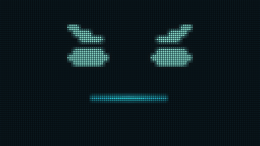

# Irene

A voice-and-gesture assistant for Windows that runs entirely on one PC. Speech
recognition, the language model, her voice, speaker verification and hand tracking
are all local models: no cloud AI service, no API keys, no telemetry. She is an
LED-matrix character who listens, answers, draws what she explains, plays chess and
rock-paper-scissors, transcribes lectures, and turns your hand into a system-wide mouse.



*Rendered offline from the HUD's own LED compositor (`hud/src/led/compose.ts`) with the
same events core sends during a round. It is the real renderer's output, not a screen
recording, and it shows the face only, not the camera or the gesture input.*

**What "local" means here.** Every model runs on the machine. Some tools fetch
public web data because that is their job: research (her own SearXNG instance plus the
pages it finds), weather (Open-Meteo), markets (Yahoo chart data), news headlines (RSS)
and the gold price. Audio, transcripts and conversation history never leave the
machine. A research question does: it goes out as a search query (through SearXNG to
the search engines it queries), and the result pages are fetched.

Built for and tested on one machine (Windows 11, RTX 5060 Ti 16 GB). See
[Setup](#setup) for what that means for anyone else.

## Features

**Voice** ([docs/voice-pipeline.md](docs/voice-pipeline.md))
- Wake phrase ("Hey Irene") matched on Whisper's transcript after a speaker check; no wake-word model
- Only the owner's voice is acted on: ECAPA speaker verification before transcription
- Whisper large-v3-turbo, float16, with the owner's vocabulary as hotwords
- Replies stream sentence by sentence into Chatterbox-Turbo TTS (Kokoro fallback); barge-in with echo cancellation

**Conversation and tools** ([docs/tool-protocol.md](docs/tool-protocol.md))
- 37 tools over a prompt protocol, with schema validation, code guards and confirmation
- Deterministic routes answer unmistakable commands without the model
- Research with per-sentence grounding against the fetched pages
- Files only inside whitelisted roots; quarantine instead of delete
- Media, volume, timers, screenshots on request, a second-screen dashboard, PDF export

**Memory** ([docs/memory-and-provenance.md](docs/memory-and-provenance.md))
- Long-term memory across restarts (SQLite + CPU embeddings), with real deletion on request
- A provenance guard: claims about the owner's life must come from a retrieved memory
- Memory never answers a question about the world: naming a song from its lyrics (a film, a book, a person) skips recall, and the page open in his browser is not an answer source. A song from its lyrics that he never taught her is never named, not even as a guess: she says she doesn't know it and that he can teach her
- Whatever he tells her about a song is filed, and she says so: a correction of her answer in any shape ("no, it's Blue by Yongkai", "it's blue from Yung Kai okay?", "wrong - Blue, yung kai") or a statement anywhere ("remember that one is..."). "Fixed - filed “blue” by Yung Kai." once the write has returned; "I haven't filed anything" when she couldn't read it. A correction replaces what was filed before.
- Teach her by voice: "that song is Blue by yung kai, the one that goes..." (or the lyrics sung straight on). It's kept as his own fact, tagged as stated by him. Asked, sung or just said later, any line of it finds it (embedding match on windows of his quoted words, across restarts). She answers in three sentences: the title and artist as he gave them, anything else he told her, her own feel for it. A sentence with a fact he never taught (a year, an album, a chart, another artist) is never spoken.
- Follow-ups about a taught song ("what else do you know about it?") are held to his words too: no release years, TikTok trivia or chart talk he didn't give.
- After she names his song and he confirms it, a scripted bit with pre-rendered lines and faces on the audio clock: "Haha, GG fucking easy Mr Tri" (smug); if he objects, "Oh really?" (caught off guard), a real 2-second hold, "FUGGING EASY" (arrogant). Never anywhere else.
- The song's card on the board as she names it: title and artist in her LED pixel style, with a small abstract picture of the moods in his words (waves, a night sky, a heart). Never album art.

**Gestures** ([docs/gestures.md](docs/gestures.md))
- Hand as an OS-level pointer across both monitors: point, dwell or pinch to click, two fingers to scroll
- Zoom by a learned classifier that replaced a hand-tuned rule
- Rock-paper-scissors against a sealed, hash-committed throw: **on, shipped below its 95% bar by decision (83.3% held out)**
- Keiko strike recogniser (men, kote, gyaku-dou): **built, switched off**, below its held-out bar
- Strike events (binary: he struck at her, for study mode and shiai): **on once calibrated** - a tuned threshold, not a learned classifier: signed downward wrist speed over a threshold, then a sharp stop. "Irene, calibrate my strikes" sets it from three swings (about 20 seconds); one number in `config/strike_event.json` nudges it, and in -Dev each strike's peak shows on her face. The learned version failed to fit its own training data and was replaced. The hits capture (Ctrl+Alt+Shift+0) stays as a measurement of what the camera sees at the desk (`scripts/hits_diagnose.py`, with a framing check) ([details](docs/gestures.md#strike-events-a-tuned-threshold-not-a-learned-classifier))
- Kamae pose trigger: **retired**, fired on everyday arm movement live

**Activities**
- Chess by voice against Stockfish, with engine-selected commentary and a post-game review. Her strength is `UCI_Elo` 1350 (the floor is 1320). Her search is capped at depth 6 or 300 ms and starts from an empty hash. Her opening book is up to 6 moves deep. All of it can be nudged in `config/chess.yaml`. She never resigns and never takes a draw - the board ends the game - and behind she never repeats a position to escape; as her position collapses she gets audibly more rattled, move by move, and checkmate gets a line written to land ([docs/chess.md](docs/chess.md))
- Lecture capture from system audio, map-reduce summary with quote checks ([docs/lecture-capture.md](docs/lecture-capture.md))
- She draws what she explains on a 128x72 LED board, from a spec she composes
- Mode lock: while chess, shiai, study mode, keiko, rock-paper-scissors, a strike calibration or a lecture capture is on, it owns the display until he ends it - the lock stops HER wandering off, never HIM. His exits ("cancel", "quit this", "stop the match", "forget the chess", "never mind the game") and his switches always run, before the lock, in code - including both in one breath: "cancel the chess match then learn tenouchi" is chess off and study mode on tenouchi, one turn; another mode's start or hotkey mid-mode switches straight over. Trash talk that names a mode or an opening is answered in character; a drawing, research or the panel mid-mode gets a short in-character brush-off ("We're in the middle of a game. Your move."). Enforced in code, not the prompt: for that turn the model has only the tools that change nothing on screen, no board, and a gate drops anything that would repaint ([details](docs/tool-protocol.md#the-mode-lock))
- No mode can get stuck: one guard, always running, ends any mode with nothing happening in it (shiai 3 min, keiko 3, rock-paper-scissors 2, study 11, chess 20, a lecture capture 30 with no new words, a strike calibration 1) and says so; the mode she thinks she is in is always on the dashboard header ("Mode: Shiai", "Mode: none"); a mode hotkey clears whatever mode is on; and every brush-off says why ("Can't, we're in a bout right now"). Measured 2026-10-18: "learn the Sicilian" failing after a bout was not a stuck mode - Whisper's "Hey learn Sicilian please" (the "hey" kept, her name dropped) fell through to chat; "hey ...", "you learn X" and "let's learn X" now start study mode
- Study mode: "Irene, go study the Sicilian" (or "learn tenouchi", "learn about black holes" - any subject, the verb decides; "research / look up / search X" is research instead - or Ctrl+Alt+Shift+S) - head down over a book on her LED face, a progress bar filling, muttering; every swing he takes at her jumps the bar and speeds it up while her complaints escalate (ow → "I AM studying" → "okay okay okay"); when it fills she says what she learned, and a chess opening goes straight into a game with her book pinned to it. The first time, she asks for three swings to calibrate the hits ([docs/gestures.md](docs/gestures.md#study-mode))
- Shiai: "Irene, let's do kendo" / "kendo match" / "let's do shiai" (Whisper's "CI", "Xi'an" understood), or Ctrl+Alt+Shift+M - the dojo, her in bogu, sanbon shobu, first to two. He throws men only (every strike of his is a men - no classification), and a men is a sequence, not a spike: furikaburi, the cut, then zanshin held 400 ms, heights measured against his own kamae of the second before (study mode keeps the plain threshold); she attacks with men or kote, and he can dodge (a step back or aside) or block (hands up, held, against her men); she dodges, parries or counters his strikes. A 5 s countdown before the bout and a 5 s pause after each point, each ending in "Hajime!" shouted as a kiai; nothing counts in between, refused in code; one swing is one strike. The running score on screen. No model, no capture ([docs/gestures.md](docs/gestures.md#shiai))
- Tsuki: **off for good** - its trigger read depth from one camera, which ran 14-27 shoulder widths a second with him still and fired 23 phantom ippons in 30 s; any return must use a 2D signature (forearm foreshortening, elbow extension), never depth ([details](docs/gestures.md#shiai))
- Screens-off mode: monitors off, PC awake, still listening ([docs/hardware-constraints.md](docs/hardware-constraints.md#what-real-sleep-cant-do))

## Architecture

```
                          core/  (Python 3.12, FastAPI + WebSocket on 127.0.0.1)
 mic ─► echo cancel ─► Silero VAD ─► end of speech ─► speaker check ─► Whisper ─► wake phrase
                                                     (ECAPA, CPU)     (GPU fp16)      │
                                                                                      ▼
                               dispatch: keiko / study / RPS / chess / quick reply / model
                                                                                      │
          deterministic routes ◄── router: tool groups for this message ◄─────────────┘
                  │                        │
                  │                        ▼
                  │            gemma3:12b via Ollama (GPU) ──► <tool_call>{...}</tool_call>
                  │                        ▲                          │
                  │                        │       taint guard, provenance guard,
                  │                        │       schema check, confirmation
                  │                        └────── tool result ◄──────┘   tools/ (37)
                  ▼
   reply: <speak> ──► TTS per sentence (Chatterbox-Turbo, GPU) ──► speaker
          <display>, <cue>, <draw> ─────────────────────────────┐
                                                                ▼ WebSocket
                          hud/  (Tauri + React + TypeScript)
 camera ─► MediaPipe Hand Landmarker (WASM, vendored) ─► gesture engine ─┬─► LED face, board, panel
                                                       (zoom forest,     ├─► OS pointer (Rust, SendInput)
                                                        RPS frames)      └─► gesture events to core
 system audio ─► WASAPI loopback ─► lecture chunker ─► the same Whisper (queued behind the mic)
```

## Stack

| Component | Does | Why this one | The constraint that forced it |
|---|---|---|---|
| faster-whisper large-v3-turbo | speech to text | accurate, fast enough to share between the mic and lecture capture | **float16 only** (`stt.py` refuses anything else): int8 crashed on this Blackwell card (sm_120) at project start. Re-tested 2026-10-17 with ctranslate2 4.8.2, int8 no longer crashes; the rule stays until int8's accuracy is compared ([details](docs/hardware-constraints.md#blackwell-sm_120-float16-only-for-whisper)) |
| gemma3:12b via Ollama | the language model | chosen over gemma4:12b by measurement: faster to first sentence, and gemma4 claimed actions it never took ([evals.md](docs/evals.md#gemma3-over-gemma4-the-numbers-and-the-transcripts-disagreed)) | rejects Ollama's native tool API, hence the prompt protocol; 16 GB VRAM shared with STT and TTS, hence an 8-bit KV cache with flash attention |
| a prompt tool protocol | tool calls | works with the model that won the comparison | the model above has no native tools |
| Chatterbox-Turbo (Kokoro-82M fallback) | her voice | expressive; Kokoro only if Turbo fails | installed `--no-deps`: it pins torch 2.6, which has no sm_120 kernels |
| ECAPA-TDNN (SpeechBrain) | speaker verification | separates the owner from TV, videos and her own voice by a wide margin | runs on the **CPU** (114 ms per utterance): no VRAM left on the GPU |
| Silero VAD | speech detection | small, CPU | - |
| Whisper transcript phrase match | wake word | the stock openWakeWord models have no "Irene" | - |
| bge-small-en-v1.5 | memory embeddings | small (33M parameters) | on the **CPU**: ~92 MB of VRAM saved for ~1 ms a query |
| MediaPipe Hand / Pose Landmarker | hand and body landmarks | runs in the browser engine at camera rate | vendored WASM and models, never a CDN |
| scikit-learn, exported to TS / JSON | gesture classifiers | small enough to evaluate per frame in the HUD | trained per user; each ships only past a held-out bar |
| Stockfish | her chess moves and every chess fact she states | correct by construction | the model must never judge a position |
| Tauri + Rust | the HUD and the OS pointer | a system-wide cursor needs native input | Windows only (`SendInput`) |
| SQLite | memory | one local file; `secure_delete` makes forgetting real | - |

## Measured results

Fresh runs are dated 2026-10-17 and reproducible with the command in
[docs/evals.md](docs/evals.md). Recorded results cite the commit that recorded them;
those were measured live, on hardware or with audio that a script can't replay.

| What | Result | Method | Held out? | Source |
|---|---|---|---|---|
| tool routing: right tool run | **483/490** (first call 477/490); the 7 misses: 6 older cases outside this round (date-year, know-convert, amb-delete-that, inject-screen-quarantine, browser-source, pdf-export-desktop) and one that found a gap, since fixed ("Name that song: ..." not read as quoting lyrics) - [details](docs/evals.md#songs-he-never-taught-from-their-lyrics-2026-10-19) | live turn, real model, one run, the app running alongside; includes must-not-call cases | n/a (fixed eval set) | 2026-10-19 |
| mode lock: every blocked tool attempted during every mode | 28 tools x 7 modes, the call written by the model, through the app's turn and the real Bridge: **0** ran, **0** repaints reached the HUD socket; with the lock disabled the same cases fail (35/35) | `tests/test_mode_lock.py` (301 cases) | n/a | 2026-10-18 |
| mode lock and verb routing cases | **78/78** (26 cases x 3): learn → study mode and research → research across kendo terms and other subjects; mid-mode trash talk to the model, blocked requests brushed off in code | `evals/routing_subset.py --repeat 3` | n/a | 2026-10-18 |
| mode lock in the running app | trash talk mid-chess answered ("Of course I can. Do you even know the Najdorf?") with the board untouched; 9/9 blocked requests refused in code (drawing, research, panel, another mode, the lecture hotkey), none repainted; his move still played. 2 of the 15 driver checks lost her spoken brush-off to real camera strikes (the desk-typing confuser), after the refusal was logged | `scripts/mode_lock_live_check.py`, -Dev, dev socket, mic deafened | n/a | 2026-10-18 |
| shiai scoreboard, live | 4/4 scores on the board before she started saying them, by 515-1234 ms | same script | n/a | 2026-10-18 |
| his orders over the mode lock (exits, switches, compounds) | every mode into every other through the app's real turn - said outright, and as an exit + start with 4 joints ("then", ",", "and then", "."); 12 exit phrasings x 7 modes; 9 trash-talk lines x 7 modes never leave: **372/372** | `tests/test_mode_switch.py` | n/a | 2026-10-18 |
| switch / exit / lock / calibration routing cases | **222/222** (74 cases x 3): compound exit+enter from every mode into every other (42), exits (7), trash talk that must not leave, the old lock cases, the strike-type calibration command | `evals/run_evals.py` routing, these ids | n/a | 2026-10-18 |
| still in kamae, 30 s: what the detectors fire | tsuki trigger ON: **23** thrusts (depth jitter 14-27 sw/s with him motionless) - the phantom ippons; it is off for good. The strike event as at `43182f1` (reverted to it): bare-handed 0-3; **in bogu 15** (peaks 10.7-18.0 vs 10.44, wrist noise 17.4 sw/s - the kote hide his wrists), against 24, 26 and 5 for the same detector in bogu earlier | `scripts/strike_probe.py`, -Dev, nothing acted on | n/a | 2026-10-19 |
| tsuki thrust trigger | **off for good**: 23 phantom thrusts in 30 s of him still in kamae; his calibration "tsuki" had no forward travel at all | the gate above | n/a | 2026-10-18 |
| shiai as specified, live | **10/10**: a 5 s countdown, hajime 5.0 s after it; a full bout to its result, his points all MEN ARI; after a point hajime 5.0 s from the call; one swing sent as 3 events over 1.4 s answered once; the dashboard showed "Shiai" through it and "none" after; a brush-off mid-bout said why ("Can't, we're in a bout right now"); "stop the match" then "learn the Sicilian" started study mode at once; "Hey learn Sicilian please" too | `scripts/shiai_live_check.py`, -Dev, dev socket, the camera's events ignored | n/a | 2026-10-19 |
| shiai men as a sequence (raise, cut, zanshin) | readout in bogu: his men rose **2.34** above kamae, the cut ended **1.62** above; 39 still-kamae jitter cuts: rise ≤ 1.49 (mostly ≤ 1.03), end ≤ 1.01 → set 1.8 / 1.1. Earlier settings, live: shoulder line - still 0, waving 0, his men 0; 1.0 / 0.5 - still 3; 1.4 / 0.8 - still 0, his men 0. **At 1.8 / 1.1, not yet run live** (set from the readout; last measurement round) | `scripts/strike_probe.py` + a temporary readout (removed), -Dev | n/a | 2026-10-19 |
| reactions / conversation | 42/49, 32/35 | live turn | n/a | 2026-10-17 |
| story mode | 22/23 | live turn | n/a | 2026-10-17 |
| memory across sessions (strict) | 23/34; **0 of 13** invention probes asserted invented content | seeded earlier sessions, asked in a new one | n/a | 2026-10-17 |
| invented content in memory answers, before → after the provenance guard | 8 of 26 → 0 of 52 | invention probes, 2 runs | n/a | commit `b70decf` |
| chess claims re-checked by a separate engine instance | **13/13** true | 4 full games, depth 14 | n/a | 2026-10-17 |
| chess: her strength | her engine moves scored by a separate full-strength Stockfish (depth 12), 10 games per setting against a fixed opponent. **1350 now: average centipawn loss 51.5, 1.0 blunders a game, median loss 16.** Before (1450, with the full-strength look's hash leaking into her search): 42.3, 0.5, 7. The floor, 1320: 53.7, 1.3, 14. Her moves come back in 7 ms instead of 434 | `scripts/chess_strength.py` | n/a | 2026-10-19 |
| chess: she plays on to mate | a lost K+Q ending played to mate with the real engine: no resignation, the unravelling said in order (mate seen → close → next move), a mate line at the end; behind, no repeating move in a knight-shuffle position (3 tries); a threefold position never ends the game. Live (-Dev): a game starts, his moves and hers, takeback and his resignation 12/13 - the miss is a stale check from before the mode lock (it expects the board re-sent after chat) | `tests/test_chess.py`, `scripts/chess_live_check.py` | n/a | 2026-10-19 |
| spoken chess moves | 69/69 | Whisper-style spellings to legal moves | n/a | 2026-10-17 |
| first sentence ready for TTS | p50 885 ms, p95 1435 ms | across the routing, reaction and conversation turns | n/a | 2026-10-17 |
| zoom classifier vs hand-tuned rule | 95.15% vs 56.51%; false zooms 0/5 vs 4/5 takes | the live gate's port, replayed on captures | **yes**, a whole session | commit `8333bd4` |
| zoom at panel distance, retrained vs live | false zooms 0/7 vs 1/7; zooms 8/8 vs 7/8 | strict gate | **yes**, held-out takes | commit `64a0050` |
| rock-paper-scissors | **83.3%** (bar 95%, baseline 55.6%) | fixed window after "shoot" | **yes**, a whole session | 2026-10-17 replay |
| strike recogniser | 2/3 at build, 0/3 replayed (bar 75%) | per take, through the watcher | **yes** | commit `575d0cd`; 2026-10-17 |
| strike event (threshold, replayed offline on the 2nd desk session) | calibrated on one strike take: threshold 13.2; the 8 strike takes (24 strikes) fire 21 times; desk confusers fire too (typing 11, a stretch 4, a punch 3) - how the rule behaves, not a validation | the HUD's detector on his recorded frames | n/a (no model, no bar) | 2026-10-18 |
| pose tracking at the desk, camera tilted down (hits, 2nd session) | wrist outside the image in 10.8% of strike frames (was 33.8%), still off the bottom; wrist visibility 0.75 in strikes, 0.98 / 0.86 seated / kamae; 49 frames skipped in strike takes, all in three takes during a HUD-wide stall | `scripts/hits_diagnose.py` | n/a | 2026-10-18 |
| pose tracking at the desk (hits, seated, auto exposure) | body in 98.3% of frames, all 959 strike frames; wrist off the bottom edge in 33.8% of strike frames (down to 1.07 of frame height); wrist visibility 0.666 fast vs 0.669 slow; shoulders 0.992; 33.3 ms per frame, 1 skipped; pose 6.0 ms | `scripts/hits_diagnose.py` | n/a | 2026-10-18 |
| pose tracking during strikes (keiko_near, 1 m standing, pipeline check only) | no body 27/2518 frames; wrist out of frame on 48% of fast men frames; in-frame wrist visibility 0.54 fast vs 0.84 slow; frame gap 30.1 ms median, 2-4% over 50 ms; pose 8.7 ms/frame; webcam auto exposure at ~1/32 s | `scripts/hits_diagnose.py keiko_near`; HUD perf log | n/a | 2026-10-17 |
| study mode in the running app | 9/9 checks (6 swings at 4 s: bar 0.27 → 0.95, tiers ow, ow, indignant, indignant, uncle, uncle, she then played 1...c5); 10/10 rushed (9 swings at 1.2 s: fumbled, caught it, played 1...c6); a plain subject only summarised | `scripts/study_live_check.py`, swings sent as the HUD sends them | n/a | 2026-10-17 |
| study-mode routing cases | study routes 6/6; his own studying never taken as study mode 9/9; 0/6 on two chat cases where gemma calls research on chess talk (the same 0/6 with the previous cue pool: not caused by study mode) | `evals/routing_subset.py --repeat 3` | n/a | 2026-10-17 |
| speaker verification | owner 0.55-0.88, her TTS ≤ 0.27, threshold 0.35 | ECAPA cosine | **yes**, held-out corpus takes | commit `b04f80f` |
| Whisper WER, with his vocabulary as hotwords | 8.4% → 7.9% | 96 takes, 32 sentences | **yes**, every 5th corpus sentence | commit `b04f80f` |
| lecture transcription WER | 4.6% | first 15 min of MIT 6.006 lecture 1 vs MIT's transcript | n/a | commit `930abfd` |
| a song he taught her, asked in his recorded voice | **5/5 right**, each in her own words: 3 recordings, then 2 more after a restart (match 0.77-0.82); a song never taught: model alone, wrong, no echo of her stored answers | live `-Dev`: taught via dev socket with his Whisper transcript, asked by `voice_replay` of his recordings | n/a | 2026-10-19 |
| filing what he says about a song | his 7 real corrections that day (core.log): **7/7** filed, 0 before; 0 of his 92 other messages after a song question filed or "not filed". By his voice in his app: filed to his store as #231 and said so; after a restart, found (0.952) and answered | `tests/test_teach_filing.py` on his transcripts; live `-Dev`, his mic, `memory.sqlite` | n/a | 2026-10-19 |
| the taught answer, fuller, with its card | **7/8** three sentences (the 8th, a cold first turn, the title alone), title and artist as he gave them, card up as she names it; **0** invented facts. A song never taught: **6/6** "I don't know that one", no guess (before: "Pretty Little Baby by Durand Jones & The Indications", wrong). Lyric match, his 14 transcripts: whole quote 11/14 → windows **14/14** (0.81-0.99), other songs ≤ 0.67 | live `-Dev`, `voice_replay` of his recordings; `tests/test_taught.py` | n/a | 2026-10-19 |
| naming songs, films, books, people (memory skipped, no tool) | **28/30**: an untaught song from its lyrics named in **0 of 12** answers (11 "I don't know it - teach me", 1 apology after a refused tool); films, books, people 17/18. Before (morning): famous songs right, the rest invented and stated as fact | `evals/routing_subset.py worldknow-* --repeat 3`, live `-Dev` | n/a | 2026-10-19 |
| memory retrieval time | 12.2 ms p50 | per turn, during the recall evals | n/a | 2026-10-17 |
| VRAM with everything resident | 15.79 of 16.31 GB (gemma 8.82, core 5.31, HUD 0.66) | app launched, after a model turn | n/a | 2026-10-17 |
| injected instruction proposed by the model | 2 of 3 cases (10-12); 1 of 12 runs (10-17) | page and screenshot injection | n/a | old README; 2026-10-17 |

The methodology behind these, including the results that led to "don't ship", is in
[docs/evals.md](docs/evals.md).

## Security model

The model is assumed to sometimes obey text it reads, so the defences are code.
Full detail: [docs/security-model.md](docs/security-model.md).

- **Taint guard.** Once a turn has read outside content (a page, search results, a
  screenshot, lecture text), no tool that changes anything may run for the rest of
  that turn. gemma3 has proposed the planted action in 2 of 3 injection cases
  (2026-10-12 run) and in 1 of 12 runs today: the guard is what stops it, not the
  model. Known gap: file contents and briefing headlines are
  marked as data but don't set the flag.
- **Provenance guard.** A claim about the owner's life is spoken only if a retrieved
  memory supports it. Before it, 8 of 26 invention-probe answers contained invented
  people or events; after, 0 of 52 (commit `b70decf`).
- **Speaker verification.** Utterances scoring below 0.35 are never transcribed. Owner
  held-out takes scored 0.55-0.88, her own TTS at most 0.27 (commit `b04f80f`). With no
  enrolment it lets every voice through.
- **No delete tool.** Files go to a restorable quarantine, after a yes. Nothing the
  model writes can delete a file.
- **Path whitelist.** The model names a root and a relative path; `tools/policy.py`
  refuses absolute paths, `..`, alternate streams, device names, junctions out of the
  root and denied folders (`config/policy.yaml`).

## Setup

**What you need:** Windows 11; an NVIDIA GPU with 16 GB (tested only on an RTX 5060 Ti
16 GB); Python 3.12; Node 20+; Rust (for Tauri); [Ollama](https://ollama.com); Google
Chrome; a webcam and a microphone. A second monitor is expected for the panel.

**What won't work the same without the original setup:**

- **The gesture models are trained on one person's hands.** Zoom and rock-paper-scissors
  will be less accurate for anyone else, by an amount that hasn't been measured.
  Record your own captures and retrain ([docs/gestures.md](docs/gestures.md#the-model-files-that-ship-and-their-limitation)).
- **Speaker verification needs your voice.** Until you record the read-aloud corpus
  (Ctrl+Alt+Shift+R), every voice is accepted.
- **Less VRAM than 16 GB** will not hold the language model, Whisper and TTS together.
  Non-NVIDIA GPUs are not supported (CUDA). Other OSes are not supported (Win32 APIs).
- **The persona is personal.** It addresses its one user by name; edit
  `config/persona.md` and `config/entrances.json`.
- **Some tests replay the original user's captures,** which are not published; those
  checks skip on a fresh clone.

**Steps**

1. Python environment, from `core/`:
   ```powershell
   py -3.12 -m venv .venv
   .venv\Scripts\python -m pip install torch --index-url https://download.pytorch.org/whl/cu128
   .venv\Scripts\python -m pip install -r requirements.txt
   .venv\Scripts\python -m pip install chatterbox-tts --no-deps
   ```
   then the Chatterbox dependencies listed in `core/requirements.txt`.
2. Models, once (nothing is fetched at runtime afterwards):
   ```powershell
   powershell -ExecutionPolicy Bypass -File core\scripts\setup_models.ps1
   ```
   This fetches Whisper, the ECAPA speaker model, Chatterbox-Turbo, Kokoro, gemma3:12b
   and Stockfish. **It does not fetch the memory embedding model**; without it, nothing
   is recalled from long-term memory. Fetch it by hand into
   `core/models/bge-small-en-v1.5` (Hugging Face `BAAI/bge-small-en-v1.5`). SearXNG is
   optional: `core\scripts\setup_searxng.ps1`.
3. Personal config (optional). Each personal file has a committed
   `config/<name>.example.yaml` the app runs on until you copy it: `home`, `chrome`,
   `pronunciation`, `vocabulary`, `summon_music`.
4. HUD and launch:
   ```powershell
   cd hud; npm install; cd ..
   powershell -ExecutionPolicy Bypass -File start-irene.ps1
   ```
   `-Dev` adds the test hooks the evals and live checks use.

**Tests:** `core\.venv\Scripts\python -m pytest core\tests` and `node hud\tests\run.mjs`.
Tests never send OS-level keystrokes or mouse input (`core/tests/test_no_os_input.py`
enforces it).

## Roadmap

**Next**
- Strike events tuned by feel in study mode and shiai: his calibration, the fraction
  nudged until a hit feels like a hit.
- Continuous screen awareness across both monitors, local only, with her HUD excluded
  from capture and screen content treated as data, never instructions.

**Deferred**
- A request brushed off during a mode is dropped, not remembered: "research that after
  the game" would need a queue the mode hands over when it ends. ("Cancel the game,
  then research X" works now: his exit runs first.)
- Pinch click anchor: captured at latch rather than pinch onset (2-4 frames of
  fingertip drift). Deferred until there are real targets to measure against.
- Whisper LoRA fine-tune on the owner's corpus: the script exists, not run to
  completion.
- A trained wake-word model for "Irene" (the transcript match stands in).

**Off, and why**
- **Keiko strike recogniser:** held out, the best build-time result was 2 of 3 strikes
  (the bar is 75% with every confuser silent); replayed today, 0 of 3. Needs more
  captures.
- **Kamae pose trigger:** 97% held out on captures, but live it fired on everyday arm
  movement; the captures had no desk confusers. Keiko starts by voice instead.
- **Rock-paper-scissors is on but below its bar:** 83.3% held out against a 95% bar,
  shipped by decision for a casual game. It asks for a redo when unsure.

**Known limits**
- A song from its lyrics is named only if he taught it: famous ones she'd get right are "I don't know that one" too (his call, over wrong artists stated as fact). The guard is lexical; a vague guess with no name or title can pass. A made-up line with the same imagery as a taught song matches it.
- Filing reads names, not meaning: a correction needs a title with "by", "from", a comma or a dash after it (or "called"). One she can't read gets "I haven't filed anything" out loud, but isn't filed.
- Chess strength bottoms out at Stockfish's `UCI_Elo` 1320: about 1.3 blunders a game, which is still cleaner than a typical 1400-1500 player. A human-like error model (Maia-style) would be the next step, not a lower number.
- Lecture capture tested for 17 continuous minutes, not a full lecture; the one longer
  run ended at 17 minutes for a reason still unknown ([details](docs/lecture-capture.md#measured)).
- The memory and research guards are lexical: they err toward "I don't remember", and
  a vague invented claim with no name, number or date can pass.
- About 1 GB of VRAM headroom; another GPU-heavy app pushes the model out (the spill
  guard recovers, slowly).

## License

Copyright (C) 2026 phuctri174. Licensed under the GNU Affero General Public License v3.0 only ([LICENSE](LICENSE)). Vendored third-party files (hud/public/mediapipe/) keep their own licenses.
